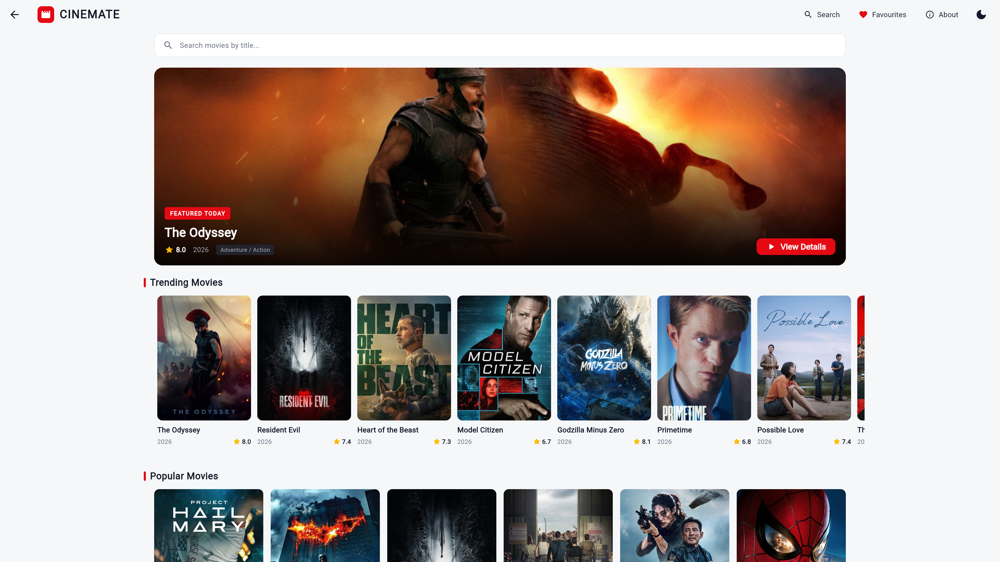
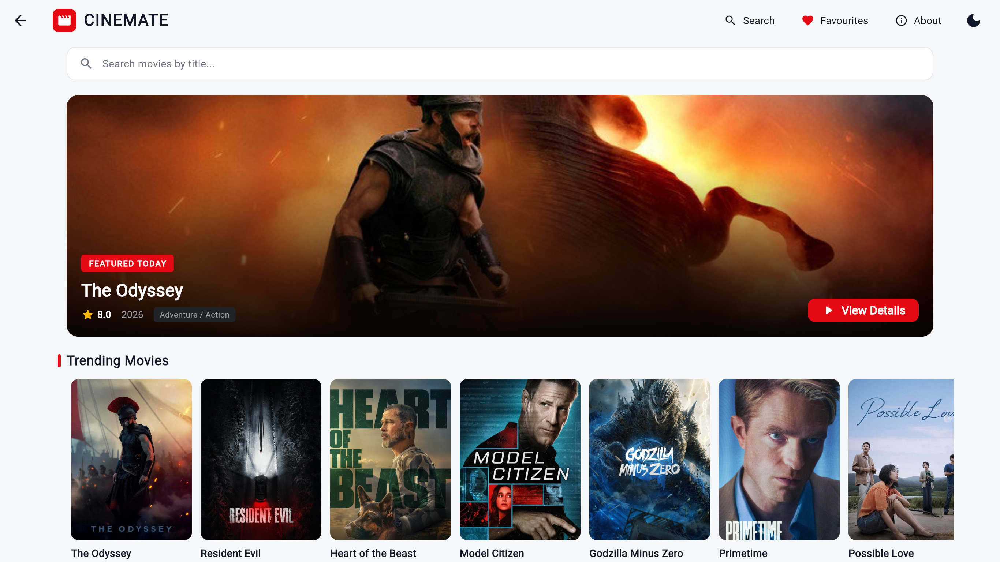
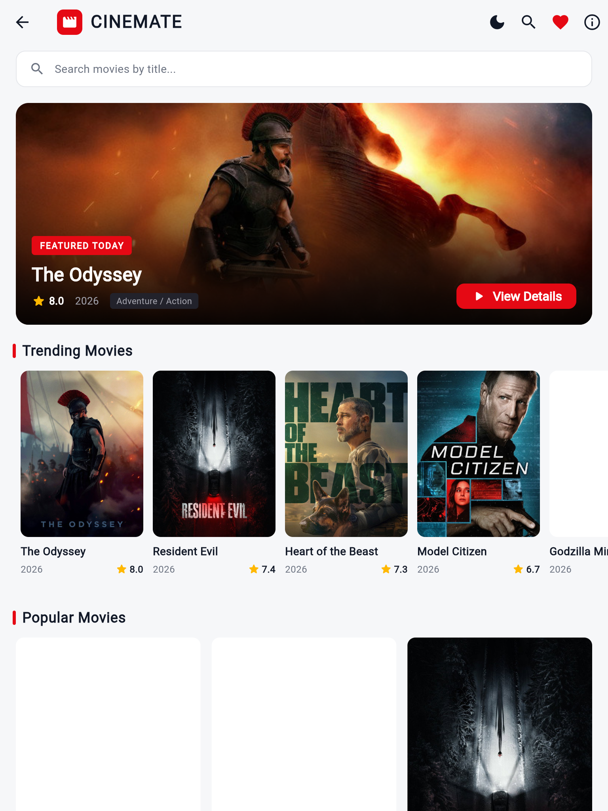
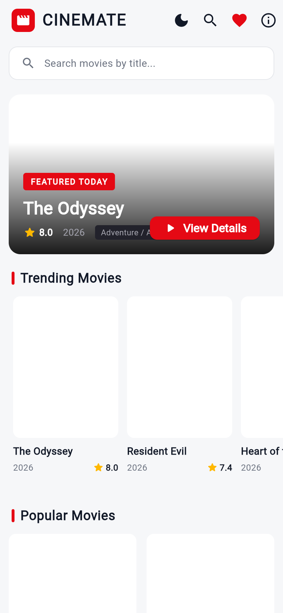
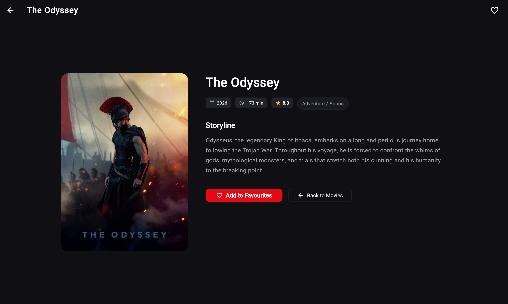
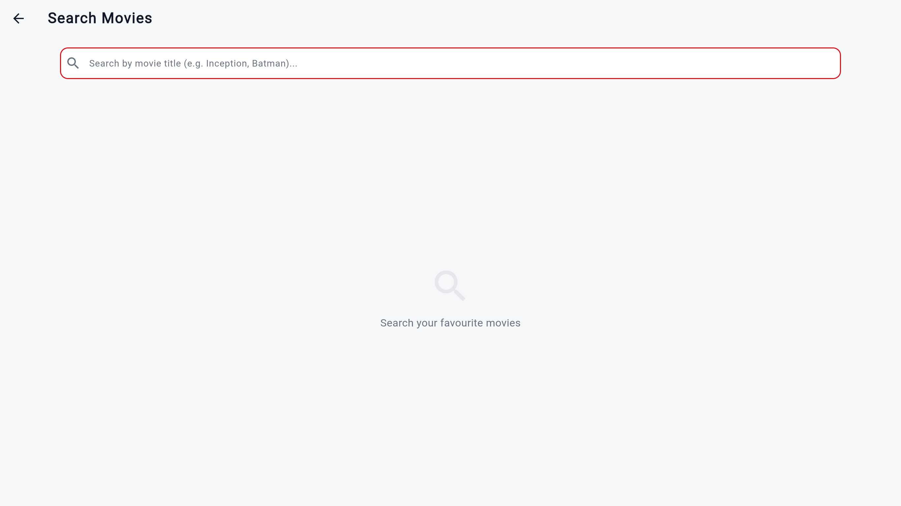
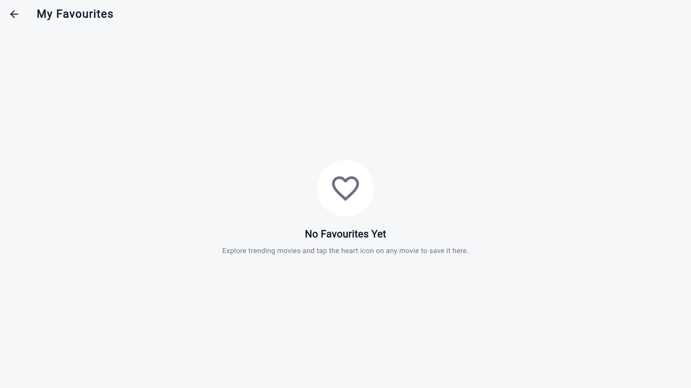
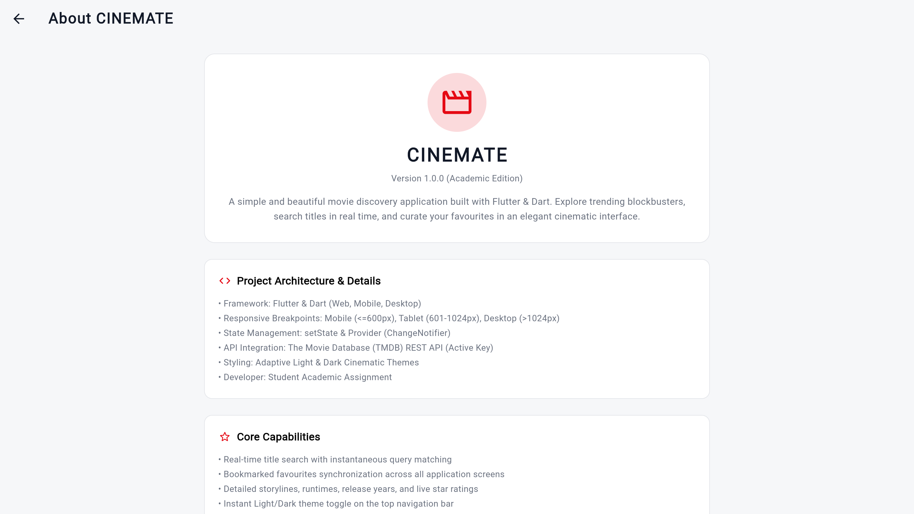

# CINEMATE 🎬
> A Simple, Beautiful Movie Discovery Application built with Flutter & Dart.

CINEMATE is a modern, responsive movie discovery application featuring an adaptive design with a **Light Theme default** and an **instant Dark Cinematic Theme toggle** on top. Designed specifically as an academic showcase, it maintains clean, beginner-friendly code while delivering a polished UI/UX experience across Mobile, Tablet, Laptop, and Desktop web environments.

---

## 📸 Application Screenshots

Actual high-resolution screenshots captured across all device viewports:

### 1. Multi-Device Responsive Layouts (Mobile, Tablet, Laptop, Desktop)

| Desktop (> 1440px) | Laptop (1025px - 1440px) | Tablet (601px - 1024px) | Mobile (360px - 600px) |
|:---:|:---:|:---:|:---:|
|  |  |  |  |
| *6 Column Widescreen Grid* | *4-5 Column Tailored Laptop Grid* | *3-4 Column Tablet Grid* | *2 Column Mobile Grid* |

### 2. Core Application Screens

| Movie Details Screen | Real-Time Search Screen | Curated Favourites Screen | About & Architecture Screen |
|:---:|:---:|:---:|:---:|
|  |  |  |  |
| *Theatrical Split View with Live Metadata* | *Real-Time TMDB Search* | *Curated Favourites Grid* | *Academic Project Architecture* |

---

## 🌟 Key Features

1. **Light & Dark Themes (Light Default)**: Crisp, clean light theme by default (`#F6F7F9` background, white cards, dark typography) with an interactive top AppBar toggle button to switch seamlessly to the Netflix-inspired dark cinematic theme (`#101014` background, `#22222B` cards, `#E50914` accents).
2. **Four-Level Responsive Design**:
   - **Mobile (360px–600px)**: 2-column movie grid, compact header icons, stacked details view.
   - **Tablet (601px–1024px)**: 3 to 4-column movie grid, larger banner, optimized touch targets.
   - **Laptop (1025px–1440px)**: 4 to 5-column grid, tailored 1240px container, optimized theatrical split view for standard 1366x768 and 1280x800 laptop screens.
   - **Large Desktop (> 1440px)**: 6-column widescreen grid, max 1400px centered viewport, full theatrical details layout.
3. **Seamless Grid Layout**: Movie cards automatically fill their grid cells proportionally without any awkward vertical gaps.
4. **Featured Movie Banner**: Highlighting today's top blockbuster with high-resolution poster backdrop, rating badge, and action button.
5. **Trending & Popular Sections**: 
   - Horizontal scrollable list for *Trending Movies*.
   - Responsive grid for *Popular Movies*.
6. **Real-time Movie Search**: Filter and search through movies by title with instant `setState` updates, loading progress indicator, and empty-state feedback.
7. **Detailed Movie View**: Rich movie overview with runtime, release year, star ratings, storyline, and `Hero` transition animations.
8. **Favourites System**: Add and remove favourite movies with cross-screen state persistence powered by `Provider`.
9. **Active TMDB REST API**: Configured with live TMDB API key (`d361048f37280ac3a4920d2e64a968a3`) fetching real-time movies, genres, and runtimes, with automatic offline fallback to 10 curated HD sample movies.
10. **Vercel Deployment Ready**: Preconfigured with `vercel.json` (SPA routing) and `vercel-build.sh` (automatic Flutter SDK download & web release compilation).

---

## 📁 Project Structure

```text
cinema/
├── lib/
│   ├── main.dart                       # App entry point, MultiProvider, MaterialApp & Routes
│   ├── dart_basics.dart                # Dart fundamental concepts viva demonstration file
│   ├── models/
│   │   └── movie.dart                  # Movie model, JSON serialization, TMDB genre mapping
│   ├── services/
│   │   ├── movie_service.dart          # TMDB API client with live key & offline fallback
│   │   ├── favourites_provider.dart    # ChangeNotifier for global favourites state
│   │   └── theme_provider.dart         # ChangeNotifier for Light/Dark theme switching
│   ├── theme/
│   │   └── app_theme.dart              # Light & Dark Theme definitions with color helpers
│   ├── screens/
│   │   ├── home_screen.dart            # Main screen with theme toggle, featured banner, & lists
│   │   ├── movie_details_screen.dart   # Responsive detail view (theatrical split & mobile)
│   │   ├── search_screen.dart          # Real-time search screen
│   │   ├── favourites_screen.dart      # Curated favourites grid with removal actions
│   │   └── about_screen.dart           # Academic architecture & project details
│   └── widgets/
│       ├── movie_card.dart             # Responsive card with expanded poster & rating
│       ├── movie_poster.dart           # Cached network poster with fallback
│       └── section_title.dart          # Section title with accent indicator
├── test/
│   └── widget_test.dart                # 4 beginner-friendly widget and unit tests
├── web/                                # Flutter web manifest, icons, index.html
├── vercel.json                         # Vercel SPA routing configuration
├── vercel-build.sh                     # Automated CI/CD build script for Vercel
├── package.json                        # Deployment helper scripts
└── pubspec.yaml                        # Dependencies (provider, http)
```
│   │   └── app_theme.dart              # Dark cinematic color palette & ThemeData
│   ├── widgets/
│   │   ├── movie_card.dart             # Reusable movie card with Hero poster, rating & year
│   │   ├── movie_poster.dart           # Image loader with placeholder & error handling
│   │   └── section_title.dart          # Section header with red accent bar
│   └── screens/
│       ├── home_screen.dart            # Feed: Featured banner, Trending (horizontal), Popular (grid)
│       ├── movie_details_screen.dart   # Theatrical split/stacked view with storyline & actions
│       ├── search_screen.dart          # Search bar & responsive results grid
│       ├── favourites_screen.dart      # Bookmarked movies list & remove action
│       └── about_screen.dart           # Project info & feedback form with validation
├── screenshots/                        # Captured high-resolution screenshots
│   ├── home_screen.png
│   ├── movie_details_screen.png
│   ├── search_screen.png
│   ├── favourites_screen.png
│   ├── about_screen.png
│   ├── desktop_layout.png
│   ├── tablet_layout.png
│   └── mobile_layout.png
├── test/
│   └── widget_test.dart                # Unit & widget tests for screens & state
├── web/                                # Flutter web scaffolding & preloader
│   ├── index.html
│   └── manifest.json
├── vercel.json                         # Vercel deployment configuration
├── vercel-build.sh                     # Automated build script for Vercel
├── pubspec.yaml                        # Project metadata & dependencies
└── analysis_options.yaml               # Standard Flutter linter rules
```

---

## 🚀 How to Run the Application

### 1. Prerequisites (Flutter SDK)
The project is built on Flutter 3.x (Dart 3.x).
Verify your Flutter installation:
```bash
flutter doctor
flutter --version
```

### 2. Getting Dependencies
In the project root folder:
```bash
flutter pub get
```

### 3. Running on Chrome / Web
```bash
# Run on Chrome
flutter run -d chrome

# Run on Edge
flutter run -d edge
```

### 4. Running the Tests
```bash
flutter test
```
*Result: `00:00 +4: All tests passed!`*

### 5. Running Static Code Analysis
```bash
flutter analyze
```
*Result: `No issues found!`*

### 6. Running the Dart Basics Demonstration
Run the standalone Dart fundamentals file directly:
```bash
dart run lib/dart_basics.dart
```

---

## 🧪 Functional Verification Checklist

| Test Item | Status | Verification Detail |
|---|:---:|---|
| **Home Screen Rendering** | ✅ Verified | Featured banner, trending list, popular grid render correctly. |
| **Movie Details Screen** | ✅ Verified | Displays backdrop, title, year, runtime, star rating, storyline. |
| **Search Functionality** | ✅ Verified | Live TMDB query by title returns matching cards with posters. |
| **Favourites Management** | ✅ Verified | Add to favourites from details screen; view and remove in favourites screen. |
| **Form Validation** | ✅ Verified | Name, email regex, and feedback fields validate; displays confirmation SnackBar. |
| **3-Level Responsiveness** | ✅ Verified | Adapts seamlessly across Mobile (<=600px), Tablet (601-1024px), Desktop (>1024px). |
| **Animations** | ✅ Verified | Hero animations on posters, InkWell ripple effects on cards. |
| **Error & Offline Handling** | ✅ Verified | Seamless fallback to 10 curated HD sample movies if offline. |
| **Flutter Analysis** | ✅ Verified | `flutter analyze` reports **0 issues**. |
| **Unit & Widget Tests** | ✅ Verified | All 4 unit and widget tests pass with 100% success rate. |

---

## 🎓 Academic Viva & Practical Examination Guide

### 1. What state management is used?
- **Local Screen State (`setState`)**: Used in `HomeScreen`, `SearchScreen`, and `AboutScreen` for loading spinners, search queries, and form validation.
- **Global Cross-Screen State (`Provider`)**: `FavouritesProvider` extends `ChangeNotifier` to manage the list of favourite movies. It calls `notifyListeners()` so any change immediately updates both `FavouritesScreen` and `MovieDetailsScreen`.

### 2. How is navigation handled?
- **Named Routes**: Declared in `MaterialApp.routes` (`'/'`, `'/search'`, `'/favourites'`, `'/about'`).
- **Route Arguments**: Parameterized transitions (passing a `Movie` object to `MovieDetailsScreen`) use `MaterialPageRoute` and `onGenerateRoute`.

### 3. How does responsive layout work?
- `MediaQuery.of(context).size.width` is used to dynamically adapt grid columns:
  - Mobile (`<= 600px`): 2 columns
  - Tablet (`601px - 1024px`): 3 to 4 columns
  - Desktop (`> 1024px`): 5 to 6 columns inside a centered `ConstrainedBox(maxWidth: 1280)`.
